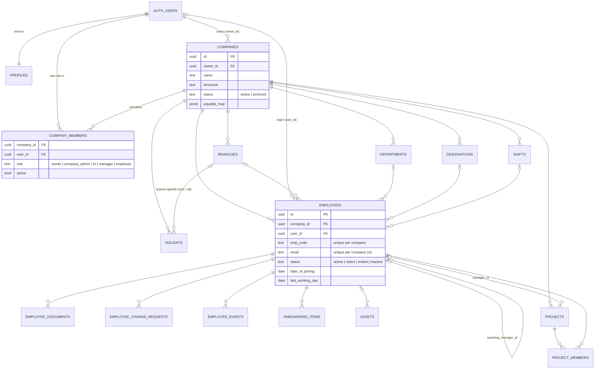
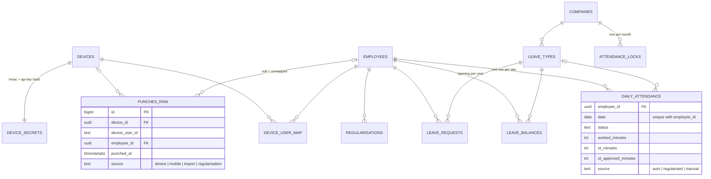
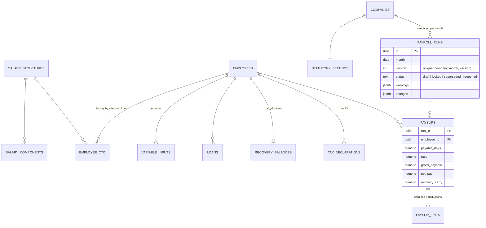
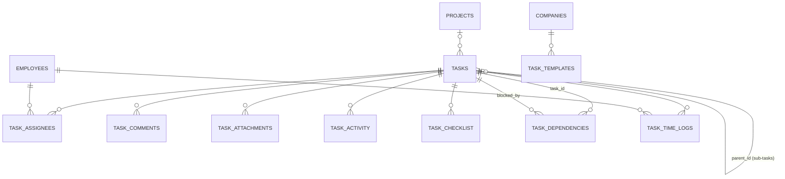
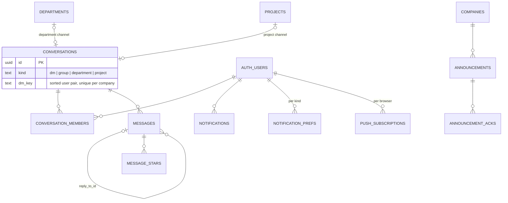
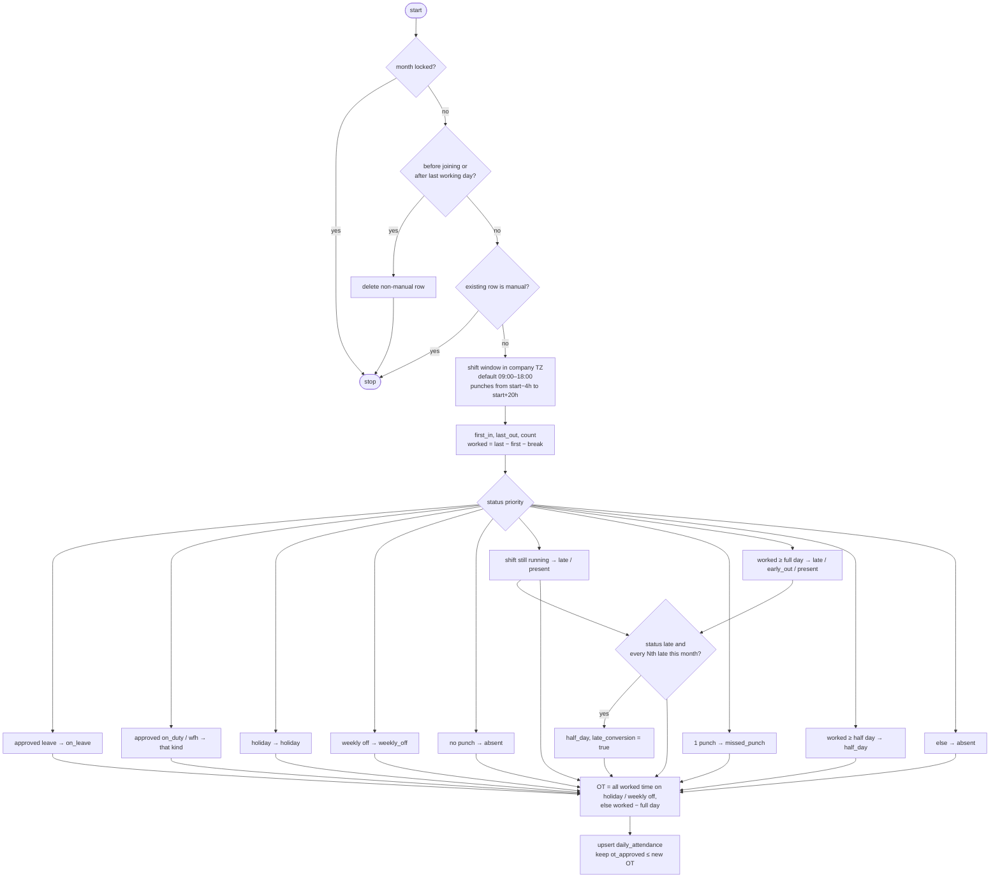

# Database architecture: corpgroup.com

The database is the core of this application. Besides storing data, it **enforces permissions (RLS), integrity rules (triggers) and the attendance and payroll calculations (PL/pgSQL)**.
This document describes the schema as defined by `supabase/migrations/` (migrations 0001 to 0033). For the application side, see [`system.md`](./system.md).

> **The migrations are the source of truth.** If this document and a migration disagree, the migration wins. Please update this file in the same PR.

---

## Contents

1. [Platform and conventions](#1-platform-and-conventions)
2. [Migration history](#2-migration-history)
3. [Entity-relationship diagrams](#3-entity-relationship-diagrams)
4. [Tables by domain](#4-tables-by-domain)
5. [Security: RLS helpers and policies](#5-security-rls-helpers-and-policies)
6. [Triggers](#6-triggers)
7. [Functions (RPC and internal)](#7-functions-rpc-and-internal)
8. [The attendance engine](#8-the-attendance-engine)
9. [The payroll engine](#9-the-payroll-engine)
10. [Views](#10-views)
11. [Storage buckets](#11-storage-buckets)
12. [Realtime](#12-realtime)
13. [Scheduled jobs (pg_cron)](#13-scheduled-jobs-pg_cron)
14. [Indexes](#14-indexes)
15. [Sensitive data and encryption](#15-sensitive-data-and-encryption)
16. [Data lifecycle and retention](#16-data-lifecycle-and-retention)
17. [Changing the schema safely](#17-changing-the-schema-safely)

---

## 1. Platform and conventions

| Item | Value |
|---|---|
| Engine | Supabase Postgres (Mumbai, `ap-south-1`) |
| Schemas used | `public` (all app tables), `auth` (Supabase users), `storage` (files), `extensions` (`pgcrypto`), `cron` (`pg_cron`) |
| Extensions | `pgcrypto` (HMAC, digests, random bytes), `pg_cron` (scheduled jobs) |
| Tests | `tests/db.ts` loads every migration into **PGlite** with small stubs for `auth.users`, `auth.uid()`, `storage.*` and the `anon` / `authenticated` / `service_role` roles |

### Conventions used throughout

| Convention | Detail |
|---|---|
| Primary keys | `uuid default gen_random_uuid()`. High-volume, append-only logs use `bigint generated always as identity` (`audit_log`, `login_attempts`, `login_history`, `punches_raw`, `task_activity`, `payslip_lines`) |
| Multi-tenancy | Every tenant row has `company_id uuid not null references companies(id) on delete cascade`. Deleting a company deletes all its data |
| Users | Users are `auth.users(id)`. `public.profiles` mirrors id, email and name. An **employee** (`employees`) is linked to a login through `employees.user_id` (nullable until the invite is accepted) |
| Enumerations | `text` columns with `check (col in (...))`, not Postgres enum types. This makes adding a value a simple constraint change |
| Timestamps | `timestamptz`, default `now()`. Business dates are `date`. Local time uses `companies.timezone` (default `Asia/Kolkata`) |
| Money | `numeric`, in rupees. Payslip lines are rounded to the rupee |
| "Month" columns | A `date` holding the **first day** of the month (e.g. `2026-10-01`) |
| RLS | Enabled on **every** public table. Tables with RLS on but no policies (`otp_codes`, `login_attempts`, `device_secrets`) are reachable only with the service role |
| Helper functions | `security definer` + `set search_path = public`, so policies can check membership without recursing into `company_members` RLS |
| Errors | Raised with user-facing text. `errcode '42501'` = permission denied, `'23503'` = wrong company / missing parent, `'23514'` = rule violation, `'28000'` = device auth failure |

---

## 2. Migration history

| # | File | Contents |
|---|---|---|
| 0001 | `core` | `companies`, `company_members`, RLS helpers (`is_member`, `has_role`, `my_role`), `branches`, `departments`, `designations`, `holidays`, `audit_log` + `audit_trigger`, `notifications` + `notify`, owner auto-membership |
| 0002 | `auth` | `otp_codes`, `login_attempts`, `login_history`, `profiles` + `handle_new_user` trigger on `auth.users` |
| 0003 | `employees` | `shifts`, `employees`, auto employee code, self-service guard, `employee_directory` view, `employee_documents`, `employee_change_requests`, `employee_events`, `onboarding_items`, `assets` |
| 0004 | `projects` | `projects`, `project_members`, project access helpers |
| 0005 | `attendance` | `devices`, `device_secrets`, `device_user_map`, `punches_raw`, leave tables, `daily_attendance`, `regularisations`, `attendance_locks`, **attendance engine**, ingestion, mobile punch, month lock |
| 0006 | `payroll` | Salary structures and components, `employee_ctc`, `statutory_settings`, `variable_inputs`, `loans`, `recovery_balances`, `payroll_runs`, `payslips`, `payslip_lines`, **payroll engine**, company bootstrap |
| 0007 | `tasks` | `tasks`, `task_assignees`, `task_comments`, `task_attachments`, `task_activity`, reminders |
| 0008 | `chat` | `conversations`, `conversation_members`, `messages`, `announcements`, `announcement_acks`, auto channels |
| 0009 | `platform` | Storage buckets and policies, Realtime publication, `pg_cron` jobs, `REVOKE EXECUTE` on internal functions |
| 0010 | `otp_verify_link` | `otp_codes.link_hash` (one-click verify link) |
| 0011 | `feature_completion` | Notification prefs and push subscriptions, leave carry-forward, task sub-tasks / checklist / dependencies / recurrence / time logs / templates, chat reply / forward / pin / star, chat admin controls, tax declarations + regime-aware `run_payroll`, saved filters, report schedules, data requests, retention purges, punch archive purge, chat push notifications, document expiry reminders |
| 0012 | `employees_integrity` | Format checks (email, phone, UAN, ESI, IFSC…), date rules, same-company trigger, reporting-loop prevention, case-insensitive unique email |
| 0013 | `calculate_daily_attendance` | `calculate_daily_attendance(company, date)` RPC |
| 0014 | `calculate_payroll_run` | `calculate_payroll_run(company, 'YYYY-MM')` RPC |
| 0015 | `tasks_chat_integrity` | Child rows inherit the parent's `company_id`, attachment path checks, channel sync on membership |
| 0016 | `query_indexes` | Covering and partial indexes for dashboard queries |
| 0017 | `unlock_check_locked_run` | `unlock_attendance_month` checks for a `locked` payroll run (it named a non-existent `approved` status; behaviour unchanged) |
| 0018 | `rbac` | `role_permissions` + `has_perm`, `in_good_standing`, `my_access`; `finance` role; `platform_admins` + `is_super_admin` and `sa_*` functions; employees / salaries / tasks policies rewritten per the BRD §4 matrix; `employee_pay_fields` view + `update_employee_pay_fields`; `payroll_run_locked`; guards in `run_payroll` / `payroll_precheck` |
| 0019 | `rbac_decisions` | Super Admin acts as Administrator (`sa_acting`, audited via `audit_log.via_super_admin`, `zz_sa_audit` triggers, `sa_log_access`); payroll maker-checker in `approve_payroll`, `reopen_payroll(run, reason, confirm)`, `payslips_locked_guard`; no employee payslip / tax access; Projects permissions; `platform_features` + leave RLS; trimmed `employee_directory`; `employees_before_delete`; no self-membership changes |
| 0020 | `companies_by_super_admin` | No API insert on `companies`; `sa_create_company(name, owner_email)` creates a company for an existing account (owner membership + employee record, audited) |
| 0021 | `join_requests` | Candidate sign-up requests (`submit_join_request`, `approve_join_request`, `reject_join_request`; admins only, audited); `designations.access_role` (Administrator-only guard); `employees.removed_at` and the directory hides removed employees |
| 0022 | `department_designations` | `designations.department_id` + `active` flags on departments and designations; names unique per department; `submit_join_request` requires an active department and an active designation **that belongs to it** |
| 0023 | `company_assignments` | One person in several companies: unique `(company_id, user_id)` on `employees`; read-only view `employee_company_assignments`; Super Admin functions `sa_person_assignments`, `sa_assign_company`, `sa_update_assignment`, `sa_set_assignment_active`, `sa_assignment_history` (audited as `company_assignments`) |
| 0024 | `hr_create_employees` | HR Managers get `employees.create` (decision 24 Oct 2026); `employees_insert_guard` makes a record created without `employees.account` start with no login, no invitation, role `employee` and an active status |
| 0025 | `attendance_correction_reason` | `set_attendance_status` requires a reason (also for returning a day to automatic), checks `attendance.manage`, and writes an `attendance_correction` audit row for every correction (old → new status, reason), including days that had no record |
| 0026 | `attendance_correction_notify` | Same `set_attendance_status` as 0025, plus an "Attendance corrected" notification to the employee (date, new and old status, reason; links to `/attendance/me`, kind `attendance`). Skipped when the employee has no login or corrects their own day |
| 0027 | `brd_v2_alignment` | BRD v2.0 §5.3 matrix in `role_permissions` (six roles; `finance` retired → `hr`); role-name policies and functions switched to `has_perm` (`is_hr()` = `attendance.manage`); new permissions `company.update`, `settings.read`, `projects.read_all`, `projects.lead`, `tasks.create_own`; own approved payslips readable by the employee; `support_access` + `grant_support_access` / `revoke_support_access` and `sa_acting` requiring a live grant (OI-13); `purge_archived_companies` keeps statutory records 8 years (`companies.purged_at`); Leave switched on; employee guards split invitations (`employees.account`) from system roles (`employees.assign_role`) |
| 0028 | `owner_signup` | `create_company_for(user, name)` (service role) and `create_company(name)`: owner sign-up and owners adding companies; `submit_join_request` now refuses (employees are invited) |
| 0029 | `missed_out_and_retention` | `companies.missed_out_grace_hours` (default 2) used by `compute_attendance_day` for ATT-36 with a one-time "Missed check-out" notification; `companies.selfie_retention_days` (default 90); `retention_storage_due()` lists selfies and purged-company documents for the daily `/api/cron/retention` job |
| 0030 | `work_from_home` | `employees.wfh_eligible`, `companies.wfh_capture_gps`; tables `wfh_days`, `work_sessions`, `work_breaks` (read via RLS, written only by functions); `request_wfh`, `decide_wfh`, `cancel_wfh`, `assign_wfh`, `wfh_check_in`, `wfh_break`, `wfh_check_out`, `wfh_status`, `wfh_live`, `wfh_auto_close` (from `attendance_tick`); `compute_attendance_day` derives WFH day status from worked hours |
| 0031 | `sync_system_role` | Keeps `employees.invite_role` (Job tab) and `company_members.role` (Users & roles) in step in both directions (never the owner); repairs a role set on the Job tab that never reached the person's access |
| 0032 | `run_payroll_safeupdate` | `run_payroll` empties its temporary table with `delete ... where true`: hosted Supabase (safeupdate) refuses a DELETE without WHERE on API requests, so payroll couldn't run from the app. `tests/safeupdate.test.ts` checks every function for this |
| 0033 | `wfh_regularisation_eligibility` | A correction of kind `wfh` is refused unless the employee is WFH-eligible (ATT-21); on-site and field staff record attendance by punches |

> Some functions are **redefined** in later migrations (`create or replace`). The live version is the one in the **last** migration listed:
>
> | Current in | Functions |
> |---|---|
> | 0011 | `notify`, `notify_roles`, `messages_before_update`, `open_dm`, `purge_chat` (second definition in the same file) |
> | 0015 | `sync_employee_channels` |
> | 0017 | `unlock_attendance_month` |
> | 0018 | `run_payroll` (also redefined in 0006 and 0011), `payroll_precheck`, `can_view_employee`, `can_view_task`, `can_edit_task`, `employees_before_write`, `tax_declarations_before_write` |
> | 0019 | `is_member`, `has_role`, `has_perm`, `my_access`, `can_manage_project`, `can_view_project`, `approve_payroll`, `reopen_payroll` (now 3 arguments), `sa_set_company_admin` |
>
> To regenerate this list: `for f in supabase/migrations/*.sql; do grep -oE "create (or replace )?function public\.[a-z_0-9]+" "$f" | sed "s|^|$f |"; done | sort -k2`

---

## 3. Entity-relationship diagrams

The schema has about 60 tables, so it is split into domains. Every tenant table also has a `company_id → companies` relationship, which is left out of the diagrams below except where it carries meaning.

### 3.1 Tenancy, identity and organisation

### 3.2 Attendance and leave

### 3.3 Payroll

### 3.4 Tasks

### 3.5 Chat, announcements and notifications

---

## 4. Tables by domain

Columns listed are the important ones, not every column. See the migration for the full definition.

### 4.1 Tenancy and organisation (0001)

| Table | Purpose | Key columns and rules |
|---|---|---|
| `companies` | A tenant. Also holds company-wide **policy** | Statutory IDs (`gstin`, `pan`, `tan`, `pf_reg_no`, `esi_reg_no`), `state` (drives PT), `timezone`, `emp_code_prefix` + `next_emp_seq`, `fy_start_month`, `weekly_offs int[]` (0 = Sunday), payroll policy (`salary_days_basis` calendar / 30 / 26, `sandwich_paid`, `ot_multiplier`, `late_marks_to_half_day`, `payable_map` jsonb status → day value), subscription (`plan`, `employee_limit`, `renewal_date`), `status` active / archived, `archived_at`. Added in 0011: `chat_cross_dept`, `chat_retention_days` (≥ 30, default 730), `payslip_password` |
| `company_members` | User ↔ company with a role | `role` ∈ owner, company_admin, hr, manager, employee; `active`; unique `(company_id, user_id)` |
| `branches` | Locations | `lat`, `lng`, `geofence_m` (default 200) for mobile punch |
| `departments` | Org structure | Unique name per company; `active` (0022) — deactivated instead of deleted |
| `designations` | Job titles, each under a department (0022) | `department_id → departments` (`on delete restrict`, same company enforced by trigger); unique `(company_id, department_id, name)` so one title can exist in two departments; `active`; `access_role` suggested on sign-up approval (0021) |
| `holidays` | Holiday calendar | `branch_id` null = all branches |
| `audit_log` | Change history (X-05) | `table_name`, `record_id`, `action`, `old_data`, `new_data`, `ip`, `user_id`, `at` |
| `notifications` | In-app notifications | `user_id`, `title`, `body`, `link`, `read_at`, `kind` (0011) |

### 4.2 Identity and auth (0002, 0010, 0011)

| Table | Purpose | Key columns and rules |
|---|---|---|
| `profiles` | Mirror of `auth.users` (filled by trigger) | `full_name`, `email` (lower-case), `last_company_id`, `idle_timeout_min`, `dnd_start` / `dnd_end`, `consent_at` |
| `otp_codes` | Email codes and links. **Service role only** | `purpose` ∈ signup, login, reset, invite, change_email; `code_hash`, `link_hash`, `expires_at`, `attempts`, `used_at`, `invalidated_at`, `ip`, `payload` |
| `login_attempts` | Lockout counter. **Service role only** | `email`, `ip`, `success`, `at` |
| `login_history` | Successful logins | `user_id`, `ip`, `user_agent`, `method` |
| `notification_prefs` | Per-user, per-kind channels | PK `(user_id, kind)`; `in_app`, `email`, `push` |
| `push_subscriptions` | Web push endpoints | `endpoint` unique, `p256dh`, `auth` |

### 4.3 Employees (0003, 0012)

| Table | Purpose | Key columns and rules |
|---|---|---|
| `shifts` | Work shifts | `start_time`, `end_time` (end < start = crosses midnight), `grace_min`, `break_min`, `half_day_hours`, `full_day_hours`, `is_default` |
| `employees` | Employee master | Personal, job, statutory, bank and lifecycle fields. `invite_role`, `mobile_attendance`. Sensitive: `pan_enc` / `pan_last4`, `aadhaar_enc` / `aadhaar_last4`, `bank_account_enc` / `bank_last4`. Unique: `(company_id, emp_code)`, `(company_id, lower(email))`, `(company_id, uan)` where not null. Check constraints on email, phone, gender, DOB, UAN (12 digits), ESI (10 digits), IFSC, last-4 formats, enc/last4 pairs, date ordering, not own manager |
| `employee_documents` | Files in the `documents` bucket | `storage_path`, `expiry_date`, `reminded_at` |
| `employee_change_requests` | Self-service PAN / bank changes awaiting HR | `field` ∈ pan, bank; `payload_enc` (encrypted), `summary` (masked), `status` |
| `employee_events` | Lifecycle timeline | `kind` ∈ joined, transfer, promotion, resignation, exit, deactivated, reactivated; `details` jsonb |
| `onboarding_items` | Checklist (6 defaults per new employee) | `item`, `done`, `done_at` |
| `assets` | Issued assets | `serial_no`, `issued_on`, `returned_on` |

### 4.4 Projects (0004)

| Table | Purpose | Key columns and rules |
|---|---|---|
| `projects` | Projects within a company | `client`, dates, `manager_id → employees`, `status` ∈ planned, active, on_hold, completed; `task_statuses text[]` (board columns), `archived` |
| `project_members` | Membership | PK `(project_id, employee_id)` |

### 4.5 Attendance and leave (0005)

| Table | Purpose | Key columns and rules |
|---|---|---|
| `devices` | Biometric devices | `serial_no` **globally unique**, `vendor`, `mode` push / pull, `ip_allowlist text[]`, `status` online / offline, `last_seen_at` |
| `device_secrets` | Device credentials. **Service role only** | `hmac_secret`, `api_key_hash` (SHA-256) |
| `device_user_map` | Device user ID ↔ employee | Unique `(device_id, device_user_id)` and `(device_id, employee_id)` |
| `punches_raw` | Every punch, **immutable** | Unique `(device_id, device_user_id, punched_at)` for device punches; unique `(employee_id, punched_at, source)` for non-device ones. `employee_id` null = unmapped. `source` ∈ device, mobile, import, regularisation; `lat`, `lng`, `selfie_path` |
| `daily_attendance` | Computed status per employee per day | Unique `(employee_id, date)`. `status` ∈ present, absent, half_day, late, early_out, on_leave, holiday, weekly_off, on_duty, wfh, missed_punch. `first_in`, `last_out`, `punch_count`, `worked_minutes`, `ot_minutes`, `ot_approved_minutes`, `late`, `late_minutes`, `early_out`, `late_conversion`, `leave_type_id`, `leave_half`, `half_present`, `source` ∈ auto, regularised, manual |
| `regularisations` | Attendance correction requests | `kind` ∈ missed_punch, on_duty, wfh; `in_time`, `out_time`, `reason`, `status` |
| `attendance_locks` | Locked months | PK `(company_id, month)` |
| `leave_types` | Leave policy | `code` unique per company, `paid`, `annual_quota`, `accrual` ∈ yearly, monthly, none; `carry_forward_max`, `encashable`, `allow_negative`, `active` |
| `leave_balances` | **Opening** balance per year (carry-forward or HR adjustment) | Unique `(employee_id, leave_type_id, year)`. Accrued and used are derived, not stored |
| `leave_requests` | Leave applications | `from_date ≤ to_date`; half day only for a single day; `days` computed by trigger; `status` ∈ pending, approved, rejected, cancelled |

### 4.6 Payroll (0006, 0011)

| Table | Purpose | Key columns and rules |
|---|---|---|
| `salary_structures` | Named structure | — |
| `salary_components` | Lines of a structure | `code` (unique per structure; `BASIC` is special), `calc` ∈ fixed, pct_ctc, pct_basic, balance; `value`; flags `taxable`, `pf`, `esi`; `sort` |
| `employee_ctc` | Salary history | `annual_ctc` (= annual gross), `effective_from` (unique per employee), `arrears_settled` |
| `statutory_settings` | One row per company | PF (rates, ceiling, cap), ESI (rates, ceiling), PT slabs jsonb, LWF, TDS slabs (new regime) + `tds_slabs_old` etc. (old regime), standard deduction, rebate, cess, gratuity, `verified_on` |
| `variable_inputs` | One-off amounts per month | `kind` ∈ bonus, incentive, reimbursement, deduction |
| `loans` | Loans and advances | `principal`, `emi`, `balance`, `start_month`, `status` |
| `recovery_balances` | Unrecovered amount carried to next month | PK `employee_id` |
| `tax_declarations` | Regime and investment declarations per FY | Unique `(employee_id, fy_start_year)`; `regime` new / old; `items` jsonb; `declared_total` (trigger); `verified` |
| `payroll_runs` | A run of one month, **versioned** | Unique `(company_id, month, version)`; `status` ∈ draft, locked, superseded, reopened; totals; `warnings` jsonb; `changes` jsonb (net-pay diffs vs previous version) |
| `payslips` | One per employee per run | Unique `(run_id, employee_id)`. Day counts, `ratio`, `monthly_gross`, `day_value`, `earned_gross`, `taxable_income`, `gross_payable`, `total_deductions`, `net_pay`, employer PF / ESI, recovery prev / carry, `loan_applied` jsonb, `arrears_ctc_ids`, `held`, `payment_status` |
| `payslip_lines` | Earnings and deductions | `code` (BASIC, HRA, …, ARREARS, OT, BONUS, INCENTIVE, ENCASH, GRATUITY, REIMB, PF, ESI, PT, LWF, TDS, RECOVERY), `kind`, `full_amount`, `amount` (rounded), `sort` (deductions 101–110) |

### 4.7 Tasks (0007, 0011)

| Table | Purpose | Key columns and rules |
|---|---|---|
| `tasks` | Tasks | `project_id`, `parent_id` (sub-task), `status` (free text, matches project `task_statuses`), `priority` ∈ low, medium, high, urgent; `due_at`, `labels`, `position` (board order), `recurrence` ∈ daily, weekly, monthly; `source_message_id` (chat → task), reminder flags, `completed_at` |
| `task_assignees` | Assignment | PK `(task_id, employee_id)` |
| `task_comments` | Comments | `mentions uuid[]` (employee ids) |
| `task_attachments` | Files | `storage_path` must start with `{company}/{task}/` |
| `task_activity` | History | `action` ∈ created, status, edited, assigned, commented; `details` jsonb |
| `task_checklist` | Checklist items | `done`, `position` |
| `task_dependencies` | Blockers | PK `(task_id, blocked_by)`, no self-reference |
| `task_time_logs` | Timer and time logs | `started_at`, `ended_at`, `minutes` (trigger) |
| `task_templates` | Reusable templates | `checklist text[]` |

### 4.8 Chat and announcements (0008, 0011)

| Table | Purpose | Key columns and rules |
|---|---|---|
| `conversations` | Chats and channels | `kind`; unique `(company_id, dm_key)`, unique `department_id`, unique `project_id`; `last_message_at` |
| `conversation_members` | Membership | PK `(conversation_id, user_id)`; `role` admin / member; `last_read_at` (read receipts / unread); `muted` |
| `messages` | Messages | `body` or `attachment_path` required; `attachment_size ≤ 25 MB`; `edited_at`, `deleted`, `reply_to_id`, `forwarded`, `pinned_at` / `pinned_by`; `search tsvector` (generated, GIN index) |
| `message_stars` | Personal stars | PK `(user_id, message_id)` |
| `announcements` | Company-wide posts | `title`, `body` |
| `announcement_acks` | Acknowledgements | PK `(announcement_id, user_id)` |

### 4.9 Platform features (0011)

| Table | Purpose |
|---|---|
| `saved_filters` | A user's saved list filters per page (`page`, `name`, `query`) |
| `report_schedules` | Scheduled report emails (`report` ∈ attendance, employees, projects; `frequency`; `recipients text[]`; `last_sent_at`) |
| `data_requests` | DPDP export or deletion requests (`kind`, `status` open / done / rejected) |

---

## 5. Security: RLS helpers and policies

### 5.1 Helper functions used by policies

All are `stable security definer` (they read membership without hitting RLS themselves) and use `auth.uid()`.

| Function | Returns true when |
|---|---|
| `is_member(cid)` | The user is an **active** member of the company |
| `has_role(cid, roles[])` | The user is an active member with one of the roles |
| `my_role(cid)` | (returns the role text) |
| `is_hr(cid)` | Role is owner, company_admin or hr (legacy; 0018 policies use `has_perm`) |
| `has_perm(cid, perm)` | The user is a member in good standing whose role has `perm` in `role_permissions` (0018) |
| `in_good_standing(cid)` | The user's employee record (if any) is not inactive or exited (0018) |
| `my_access(cid)` | `{allowed, reason, role, permissions[]}` for the signed-in user, loaded by the app on every request (0018) |
| `is_super_admin()` | The user has a row in `platform_admins` (0018) |
| `my_employee_id(cid)` | (returns the user's employee id in that company) |
| `is_manager_of(emp)` | The user is the employee's **direct** reporting manager |
| `can_view_employee(emp)` | HR of the company, the employee themself, or their manager |
| `is_project_member(pid)` | Member or manager of the project |
| `can_view_project(pid)` | Owner / admin / HR / manager role, or project member |
| `can_manage_project(pid)` | Owner / admin / HR, or the project manager |
| `can_view_task(tid)` | HR, creator, assignee, manager of an assignee, or project member |
| `can_edit_task(tid)` | As above, but project **managers** instead of project members |
| `is_conversation_member(cid)` | The user is in the conversation |

### 5.2 Policy summary (who can read / write)

"HR" below means owner + company_admin + hr. "Admin" means owner + company_admin. "Self" means the row belongs to the user's own employee record.

| Table(s) | Read | Write |
|---|---|---|
| `companies` | owner_id or member | Insert: **none through the API** (0020), only `sa_create_company()`. Update: Admin |
| `company_members` | Members | Admin (cannot grant `owner`) |
| `branches` | Members | Admin |
| `departments`, `designations`, `holidays` | Members | HR |
| `audit_log` | HR | Triggers / definer functions only |
| `notifications` | Own | Update own (mark read). Insert via `notify()` |
| `profiles` | Self + people sharing a company | Update self |
| `login_history` | Self, or Admin of a shared company | Service role |
| `otp_codes`, `login_attempts`, `device_secrets` | **Nobody** (service role only) | Service role |
| `shifts`, `leave_types` | Members | HR |
| `employees` | HR, self, direct manager | Insert: HR. Update: HR or self (trigger limits self to phone, address, emergency contact, photo). Delete: Admin |
| `employee_directory` (view) | Members (non-sensitive columns of colleagues) | — |
| `employee_documents`, `onboarding_items` | `can_view_employee` | HR |
| `employee_change_requests` | `can_view_employee` | Insert: self or HR. Update: HR |
| `employee_events` | `can_view_employee` | Insert: HR |
| `assets` | HR or self | HR |
| `projects` | Owner / admin / HR / manager, or project member | Insert: manager and above. Update: `can_manage_project`. Delete: Admin |
| `project_members` | `can_view_project` | `can_manage_project` |
| `devices` | HR | Update / delete: Admin. Insert only via `register_device()` |
| `device_user_map` | HR | Delete: HR. Insert via `map_device_user()` |
| `punches_raw` | HR or `can_view_employee` | Only via definer functions (ingest, mobile, import, regularisation) |
| `daily_attendance` | `can_view_employee` | Only via engine / `set_attendance_status` / `approve_overtime` |
| `leave_balances` | `can_view_employee` | HR |
| `leave_requests`, `regularisations` | `can_view_employee` | Insert: self or HR. Update: self, HR or manager (the trigger decides who may approve) |
| `attendance_locks` | Members | Via `lock_attendance_month` / `unlock_attendance_month` |
| `salary_structures`, `salary_components`, `statutory_settings`, `variable_inputs` | HR | **hr + company_admin** (owner reads but does not edit) |
| `employee_ctc`, `loans`, `recovery_balances` | HR or self | hr + company_admin (`recovery_balances` via functions) |
| `tax_declarations` | HR or self | HR, or self while not yet verified |
| `payroll_runs` | HR | Via `run_payroll` / `approve_payroll` / `reopen_payroll` |
| `payslips` | HR, or self **only when the run is locked** | Update (payment status, hold): HR |
| `payslip_lines` | Same as the parent payslip | Via engine |
| `tasks` | Creator, HR, `can_view_task` | Insert: member, as creator, project visible. Update: `can_edit_task`. Delete: HR or creator |
| `task_assignees` | `can_view_task` | Insert: task editor; plain employees may assign **only themselves**. Delete: editor |
| `task_comments`, `task_attachments` | `can_view_task` | Insert: `can_view_task` (comment author = self) |
| `task_activity` | `can_view_task` | Triggers |
| `task_checklist`, `task_dependencies` | `can_view_task` | `can_edit_task` |
| `task_time_logs` | HR or `can_view_task` | Own logs only |
| `task_templates` | Members | Manager and above |
| `conversations` | Conversation members | Update: members, groups only. Create via `open_dm` / `create_group` / triggers |
| `conversation_members` | Fellow members | Insert into groups by members (target must be an active company member). Update / delete own row (mute, read, leave) |
| `messages` | Conversation members | Insert: member, as self. Update: members (trigger: only the sender edits / deletes; anyone may pin) |
| `message_stars`, `saved_filters`, `notification_prefs`, `push_subscriptions` | Own | Own |
| `announcements` | Members | Insert / delete: HR |
| `announcement_acks` | Own, or HR | Insert own |
| `report_schedules` | HR | HR |
| `data_requests` | Own, or Admin | Insert own. Update: Admin |

### 5.3 Function grants

Internal functions have `EXECUTE` revoked from `public`, `anon` and `authenticated`, so the app's users **cannot call them through the API**:
`ingest_punches` (granted to `service_role`), `attendance_tick`, `check_devices`, `task_reminders`, `compute_attendance_day`, `recompute_attendance`, `notify`, `notify_roles`, `sync_employee_channels`, `purge_chat`, `purge_archived_companies`, `purge_punches_before`, `document_expiry_reminders`.

User-callable RPCs (e.g. `run_payroll`, `lock_attendance_month`) check permissions **inside** the function and raise `42501` when the user is not allowed.

---

## 6. Triggers

| Table | Trigger (function) | When | Effect |
|---|---|---|---|
| `auth.users` | `on_auth_user_created` (`handle_new_user`) | after insert / email update | Upsert `profiles` row |
| `companies` | `companies_after_insert` | after insert | Add owner to `company_members` |
| `companies` | `companies_bootstrap` (`bootstrap_company`) | after insert | Default statutory settings, General shift, CL / SL / EL / LOP leave types, Standard salary structure, 2 departments |
| `companies`, `company_members`, `employees`, `projects`, `leave_types`, `employee_ctc`, `salary_components`, `payroll_runs`, `tax_declarations`, `statutory_settings` (update), `attendance_locks` (insert) | `*_audit` (`audit_trigger`) | after write | Row to `audit_log` |
| `daily_attendance` | `daily_attendance_audit_upd` / `_del` | after update / delete, **only for manual rows or OT approval changes** | Audit human changes, not the engine |
| `company_members` | `company_members_sync_channels` | after insert / activation | Join department and project channels |
| `employees` | `employees_before_write` | before insert / update | Auto `emp_code`; `updated_at`; non-HR may change only self-service fields |
| `employees` | `employees_same_company` | before insert / update of references | Branch / dept / designation / shift / manager must be in the same company; no reporting loops |
| `employees` | `employees_after_insert` | after insert | 6 onboarding items + "joined" event |
| `employees` | `employees_sync_channels` | after insert / update of user, department, status | Keep chat channel membership in sync |
| `departments` | `departments_after_insert` | after insert | Create department channel |
| `projects` | `projects_after_insert` | after insert | Create project channel, add manager |
| `project_members` | `project_members_after_write` | after insert / delete | Add / remove from project channel |
| `punches_raw` | `punches_immutable` | before update / delete | Refuse, except mapping an unmapped punch or a purge with `app.allow_punch_purge = on` |
| `punches_raw` | `punches_after_write` | after insert / update | `compute_attendance_day` for the local date and the day before (night shift) |
| `leave_requests` | `leave_requests_before_write` | before insert / update | Compute `days`, block overlaps, check balance, force `pending`; only manager / HR decide; no cancelling approved leave in a locked month |
| `leave_requests` | `leave_requests_after_write` | after insert / update | Notify manager / employee; recompute attendance when approval changes |
| `regularisations` | `regularisations_before_write` / `_after_write` | before / after | Locked-month check, approver check; on approval insert `regularisation` punches and recompute; notify |
| `tasks` | `tasks_before_update` | before update | `updated_at`, `completed_at`, reset reminder flags when due date changes |
| `tasks` | `tasks_check_blockers` | before update | Cannot set `done` while a blocker is open |
| `tasks` | `tasks_same_company` | before insert / update | Project and parent in same company; company cannot change |
| `tasks` | `tasks_after_write` | after insert / update | Activity row; notify on status change |
| `tasks` | `tasks_recur` | after update | Closing a recurring task creates the next one (copies assignees and checklist) |
| `task_assignees`, `task_comments`, `task_attachments`, `task_checklist`, `task_dependencies`, `task_time_logs` | `<table>_company` (`task_child_company`) | before insert / update | Force `company_id` = task's; referenced employee / blocker in same company; attachment path under `{company}/{task}/` |
| `task_assignees` | `task_assignees_after_insert` | after insert | Activity + notify assignee |
| `task_comments` | `task_comments_after_insert` | after insert | Activity + notify @mentions |
| `task_time_logs` | `time_logs_before_write` | before write | Compute `minutes` |
| `conversation_members` | `conversation_members_company` | before insert / update | Company from conversation; user must be an active company member |
| `messages` | `messages_company_and_path` | before insert / update | Company from conversation; attachment under `{company}/{conversation}/`; reply in same conversation |
| `messages` | `messages_before_update` | before update | Pin by any member; otherwise sender only; edit within 15 min; delete clears content |
| `messages` | `messages_after_insert` | after insert | `last_message_at`; sender's `last_read_at` |
| `messages` | `messages_notify` | after insert | `kind = 'chat'` notifications to un-muted members (drives push) |
| `message_stars` | `message_stars_company` | before write | Company from message |
| `announcements` | `announcements_after_insert` | after insert | Notify all members |
| `tax_declarations` | `tax_declarations_before_write` | before write | `declared_total`; non-HR edit resets `verified` |
| `data_requests` | `data_requests_after_insert` | after insert | Notify admins |

---

## 7. Functions (RPC and internal)

### 7.1 Called by the app (via `supabase.rpc`)

| Function | Who | What |
|---|---|---|
| `register_device(company, branch, name, serial, vendor, model, ip, mode)` | Admin | Creates device + secrets, returns `hmac_secret` and `api_key` **once** |
| `map_device_user(device, device_user_id, employee)` | HR | Maps an ID and attaches waiting unmapped punches |
| `mobile_punch(company, lat, lng, selfie_path)` | Employee with `mobile_attendance` | Haversine geofence check vs branch, inserts punch |
| `import_punches(company, rows jsonb)` | HR | CSV / Excel fallback (`emp_code`, `timestamp`) |
| `recalculate_attendance(company, from, to)` | HR | Recompute a range of up to 62 days |
| `calculate_daily_attendance(company, date)` | HR (or service role) | Map punches, compute, and return each employee's status for a day |
| `set_attendance_status(emp, date, status, remarks)` | HR | Manual override; `'auto'` returns the day to the engine |
| `approve_overtime(attendance_id, minutes)` | HR or manager | Sets `ot_approved_minutes` (≤ computed OT) |
| `lock_attendance_month(company, month)` | HR | Refuses with unmapped punches; recomputes then locks |
| `unlock_attendance_month(company, month, reason)` | Admin | Refuses if payroll is approved; audited |
| `carry_forward_leaves(company, year)` | HR | Opening of next year = min(balance, cap) |
| `payroll_precheck(company, month)` | HR | Errors (attendance not locked, no CTC, unmapped punches) and warnings (no bank, missed punches) |
| `run_payroll(company, month)` | HR | New draft version, returns run id. See §9 |
| `calculate_payroll_run(company, 'YYYY-MM')` | HR | Wraps `run_payroll` and returns a per-employee table |
| `approve_payroll(run)` | `salaries.approve` (Administrator or Finance / Payroll), **never the person who ran it** (maker-checker); not the Super Admin | Draft → locked; applies loan EMIs, recovery balances, arrears settled; audited |
| `reopen_payroll(run, reason, confirm)` | Owner or company admin in good standing; `confirm` must be the month typed as `YYYY-MM` | Locked → reopened; reverses those effects; **unlocks attendance**; audited |
| `open_dm(company, other_user)` | Member | Find or create the DM (respects `chat_cross_dept`) |
| `create_group(company, name, users[])` | Member | New group with caller as admin |
| `export_conversation(conversation)` | Admin | Compliance export, audited |
| `can_edit_task`, `can_manage_project` | Any | Used by the UI to show edit controls |

### 7.2 Internal (service role, triggers, cron)

| Function | Purpose |
|---|---|
| `ingest_punches(serial, body, signature, api_key, ip)` | Device webhook: verifies HMAC-SHA256 or API key hash and IP allow-list; accepts an array, `{punches:[...]}` or a single object; timestamps without offset = company local time; idempotent insert; returns `{received, accepted, duplicates, unmapped}`; marks device online |
| `compute_attendance_day(emp, date)` | The attendance engine (§8) |
| `recompute_attendance(company, from, to, emp?)` | Loop of the above for employed days |
| `attendance_tick()` | Per-minute job: recompute yesterday and today for all active companies + `check_devices()` |
| `check_devices()` | Online → offline after 15 minutes of silence; notify admins |
| `task_reminders()` | Due-in-24 h and overdue notifications |
| `notify(user, company, title, body, link)` / `notify_roles(company, roles[], …)` | Insert notifications, respecting `notification_prefs.in_app`; `kind` from `notification_kind(link)` |
| `sync_employee_channels(emp)` | Department / project channel membership |
| `structure_amounts(structure, monthly)` | Expand a salary structure into component amounts (fixed + %CTC → %Basic → balance) |
| `annual_tax(settings, income)` | Progressive slabs + rebate + cess |
| `regime_settings(settings, regime)` | Swap in old-regime slabs / deduction / rebate |
| `leave_days(emp, from, to, half)` | Working days excluding weekly offs and holidays |
| `leave_available(emp, type, year)` | Opening + accrued − used − pending |
| `is_month_locked(company, date)` | Lock check |
| `purge_chat()`, `purge_archived_companies()`, `purge_punches_before(company, before)`, `document_expiry_reminders()` | Retention and reminder jobs |
| `request_ip()` | Client IP from PostgREST `request.headers` (for the audit log) |
| `storage_company(name)`, `storage_part(name, i)` | Parse uuid folders from Storage object paths |
| `feature_enabled(feature)` | Whether a platform feature is on in `platform_features` (false when missing); used by the leave RLS policies |
| `audit_log_flag_sa()` | Trigger on `audit_log`: sets `via_super_admin = true` when a Super Admin acts in a company they are not a member of |
| `sa_write_audit()` | `zz_sa_audit` trigger function: writes an audit row for every change a Super Admin makes while acting as Administrator (`sa_acting`) |
| `designations_access_guard()` | Trigger on `designations`: only users with `employees.assign_role` may set `access_role` |

### 7.4 One person, several companies (0023)

There is no separate assignments table: the person is one login (`auth.users` / `profiles`), and an **assignment** is that person's `employees` row in a company (department, designation, reporting manager, status, joining date) plus their `company_members` row (role, active). Attendance, leave, payroll and documents hang off the per-company `employees` row, which keeps companies apart. `employee_company_assignments` is a `security_invoker` view of the pairs, and `employees_company_user` makes a second record for the same login in one company impossible.

| Function | What |
|---|---|
| `sa_person_assignments(user)` | Every company with this person's assignment there (or none) |
| `sa_assign_company(user, company, role, department, designation, manager, joining)` | Adds them to a company (or reactivates / links an unlinked record with the same email). Copies only name, email and phone — never PAN, Aadhaar, bank, salary or permissions |
| `sa_update_assignment(user, company, …)` | Edits one company's details; the owner keeps the owner role |
| `sa_set_assignment_active(user, company, active, reason)` | Switches one company off / on; other companies are untouched; returns how many active companies remain (the app blocks the login only at 0) |
| `sa_assignment_history(user)` | Assignment and membership changes across companies |

All require `is_super_admin()`, refuse the caller's own account, refuse the `owner` role and switching an owner off, and check that department, designation (and that it belongs to the department) and manager are in that company.

### 7.3 Super Admin console (`/admin`)

All check `is_super_admin()` and raise `42501` otherwise. Every change is written to `audit_log`.

| Function | What |
|---|---|
| `sa_companies()` | Every company with owner email, active employee count and its owners / admins |
| `sa_create_company(name, owner_email)` | The only way to create a company (0020): an existing account becomes Owner, with membership and employee record |
| `sa_update_company(company, plan, employee_limit, renewal, status)` | Plan, seats, renewal; `archived` sets `archived_at` (purged after 90 days) |
| `sa_set_company_admin(company, email)` | Grant `company_admin` to an existing account (not the owner) |
| `sa_remove_company_admin(company, user)` | Downgrade to employee; access is kept only if they have an employee record. The owner cannot be removed |
| `sa_permissions()` | The Administrator permission set minus `salaries.approve`: what a Super Admin can do inside a company |

---

## 8. The attendance engine

`compute_attendance_day(p_emp, p_date)` writes exactly one `daily_attendance` row (upsert on `(employee_id, date)`).

Notes:

- "Late" = first punch after shift start + grace. "Early out" = last punch before shift end (only once the shift is over).
- The shift is considered "in progress" until 4 hours after it ends. Until then the status is provisional (present / late), which drives the live board.
- Half-day leave: status is `on_leave` with `leave_half = true`. If the employee also worked half-day hours, `half_present = true`, and payroll pays the other half.
- What triggers recomputation: a new or mapped punch, approval / cancellation of leave or regularisation, `recalculate_attendance`, month lock, and the per-minute `attendance_tick`.

---

## 9. The payroll engine

`run_payroll(company, month)` (current version in 0011) creates a **new draft version** and one payslip per eligible employee (joined by month end, not left before month start, has a CTC effective by month end).

| Step | What happens |
|---|---|
| Guards | Caller is HR; `statutory_settings` exist; attendance month is **locked**; no **locked** run already exists for the month. Earlier drafts become `superseded` |
| 1. Payable days | For each day in the employee's window: day value from `companies.payable_map[status]`; paid leave = 1 (half = 0.5, + 0.5 if `half_present`); unpaid leave = 0; missing row = absent. **Sandwich rule:** if `sandwich_paid = false`, an off day between two zero-value days becomes 0 |
| 2. Ratio | `min(payable / salary_days, 1)`, where salary days = calendar days, 30 or 26 |
| Salary in force | Latest CTC by month start; a revision inside the month is weighted by days |
| 3. Earnings | Each structure component × ratio. Then: **arrears** for unsettled past revisions (vs locked payslips), **OT** = hours × day value ÷ shift hours × `ot_multiplier`, bonus, incentive, and in the exit month **leave encashment** (encashable balance × day value) and **gratuity** (≥ 5 years: 15/26 × Basic × years). Reimbursements are non-taxable and outside PF / ESI |
| 4. Statutory | PF on PF wage (capped at ceiling if set), employee + employer. ESI only if ESI wage ≤ ceiling. PT from slabs on taxable pay (with optional February amount). LWF in configured months |
| 5. TDS | Projected annual taxable = YTD taxable (locked payslips) + this month + full-month taxable × remaining months − standard deduction − (old regime: declared investments). Annual tax − TDS already deducted, ÷ remaining months |
| 6. Other deductions | Loan / advance EMIs (`min(emi, balance)`), one-time deductions, previous recovery balance |
| 7–8. Net and rounding | Each line rounded to the rupee. TDS limited to what is left after other statutory deductions. Other deductions applied only up to the available amount; the **shortfall is carried forward** (`recovery_carry`). Net pay is never negative |
| Run totals | Employee count, gross, deductions, net; warnings (pre-check + carry-forwards); `changes` = employees whose net differs from the previous version |

Approval (`approve_payroll`) is **maker-checker**: it needs the `salaries.approve` permission and a different person from the one who ran the run (`ran_by`). It also requires no `error`-level warnings, then: loans reduced (closed at 0), `recovery_balances` set to `recovery_carry`, arrears marked settled, run `locked`, payslips `pending` (or `on_hold` if held). `reopen_payroll` (owner / company admin, a reason, and the month typed as `YYYY-MM`) reverses all of these and removes the attendance lock. Once locked, payslips are read-only except `payment_status` (`payslips_locked_guard`).

**Statutory defaults** (in `statutory_settings`, editable per company, must be verified by a CA): PF 12% / 12% on a ₹15,000 ceiling; ESI 0.75% / 3.25% up to ₹21,000; PT slabs 0 / 150 / 200; new-regime TDS slabs with ₹75,000 standard deduction, ₹12 L rebate limit (₹60,000 max), 4% cess; old-regime slabs with ₹50,000 standard deduction.

---

## 10. Views

| View | Security | Purpose |
|---|---|---|
| `employee_directory` | Runs as owner, filtered by `is_member(company_id)` | Non-sensitive colleague data (name, contact, dept, designation, branch, manager, status) for chat, tasks and pickers. Lets employees see colleagues they cannot see in `employees` |
| `leave_balance_view` | `security_invoker` | Per employee / type / year (current and previous): opening, accrued (yearly = quota; monthly = quota/12 × months elapsed), used, pending |
| `final_payslips` | `security_invoker` | Payslips of **locked** runs only. Use this for YTD, arrears and reports |
| `payslip_ytd` | `security_invoker` | Per employee and financial year: gross, taxable, PF, ESI, PT, TDS, net |

---

## 11. Storage buckets

Object paths always start with the **company id**, and policies parse the folders.

| Bucket | Public | Size limit | Path | Read | Write |
|---|---|---|---|---|---|
| `logos` | yes | 2 MB | `{company}/…` | anyone | Admin |
| `documents` | no | 50 MB | `{company}/{employee}/…` | HR or that employee | HR or that employee (delete: HR) |
| `selfies` | no | 5 MB | `{company}/{employee}/…` | HR or that employee | That employee |
| `chat` | no | 25 MB | `{company}/{conversation}/…` | Conversation members | Conversation members |
| `tasks` | no | 50 MB | `{company}/{task}/…` | `can_view_task` | `can_view_task` |
| `archives` | no | — | punch archives | service role | service role |

The `messages` and `task_attachments` triggers refuse paths outside the expected folder, so the read policy cannot be bypassed by pointing at another folder.

---

## 12. Realtime

Tables added to the `supabase_realtime` publication (RLS still applies to what each client receives):

- `daily_attendance`: Attendance → Live board
- `messages`: chat
- `conversation_members`: unread counts and read receipts
- `notifications`: bell

---

## 13. Scheduled jobs (pg_cron)

| Job name | Schedule (UTC) | Command |
|---|---|---|
| `attendance-tick` | `* * * * *` | `select public.attendance_tick()` |
| `task-reminders` | `*/5 * * * *` | `select public.task_reminders()` |
| `purge-chat` | `15 2 * * *` | `select public.purge_chat()` |
| `purge-archived-companies` | `30 2 * * *` | `select public.purge_archived_companies()` |
| `document-expiry` | `0 3 * * *` | `select public.document_expiry_reminders()` |

The migrations wrap `cron.schedule` in `exception when others`, so they succeed even without `pg_cron` (e.g. in tests). Check with `select * from cron.job;` after enabling the extension and re-running `pnpm db:push`.

---

## 14. Indexes

Beyond primary keys and unique constraints:

| Table | Index | Serves |
|---|---|---|
| `company_members` | `(user_id)` | Company switcher, RLS helpers |
| `employees` | `(company_id, status)`, `(company_id, department_id)`, `(company_id, branch_id)`, `(user_id)`, `(reporting_manager_id)`, unique `(company_id, lower(email))`, unique partial `(company_id, uan)` | Lists, filters, `is_manager_of`, import duplicate check |
| `holidays` | `(company_id, date)` | Engine, leave days |
| `audit_log` | `(company_id, at desc)` | Audit screen |
| `notifications` | `(user_id, created_at desc)`; partial `(user_id) where read_at is null and kind <> 'chat'` | Notification list; bell badge |
| `otp_codes` | `(email, purpose, created_at desc)`, `(ip, created_at desc)` | OTP lookup and rate limits |
| `login_attempts`, `login_history` | `(email, at desc)`, `(user_id, at desc)` | Lockout, history |
| `punches_raw` | Unique device / non-device (see §4.5), `(employee_id, punched_at)`, partial `(company_id) where employee_id is null` | Idempotency, engine window, exceptions queue |
| `daily_attendance` | Covering `(company_id, date) include (employee_id, status)` | Dashboard "today" and 14-day trend |
| `leave_requests` | `(employee_id, from_date)`, `(employee_id, leave_type_id, status)`, partial `(company_id) where status = 'pending'` | Overlap check, balances, approvals badge |
| `regularisations` | Partial `(company_id) where status = 'pending'` | Approvals badge |
| `devices` | `(company_id, status)` | Offline devices card |
| `employee_documents` | Partial `(company_id, expiry_date)` | Expiring documents |
| `variable_inputs` | `(company_id, month)` | Payroll inputs |
| `payslips`, `payslip_lines` | `(employee_id, month)`, `(payslip_id)` | Payslip pages, YTD |
| `tasks` | `(company_id, status)`, `(project_id)`, `(parent_id)`, partial `(company_id, due_at) where status <> 'done' and due_at is not null` | Board, sub-tasks, overdue / reminders |
| `task_assignees` | `(employee_id)` | "My tasks" |
| `task_time_logs` | `(task_id)`, `(employee_id, started_at)` | Time reports |
| `conversation_members` | `(user_id)` | Chat sidebar |
| `messages` | `(conversation_id, created_at desc)`, GIN `(search)` | Message history, full-text search |
| `announcements` | `(company_id, created_at desc)` | Dashboard card |

For large production tables, create new indexes with `CREATE INDEX CONCURRENTLY`, one statement per migration and outside a transaction (see the note in 0016).

---

## 15. Sensitive data and encryption

| Data | Storage |
|---|---|
| PAN, Aadhaar, bank account | Encrypted **in the app** (`src/lib/crypto.ts`, AES-256-GCM, format `iv.tag.ciphertext` in base64) with `FIELD_ENCRYPTION_KEY`. The database holds `*_enc` + last 4 characters only; check constraints keep the pair consistent |
| PAN / bank change requests | `employee_change_requests.payload_enc` (encrypted JSON) + masked `summary` |
| OTP codes and verify links | SHA-256 hashes with `OTP_PEPPER`; never stored in clear |
| Device credentials | `device_secrets` (no RLS policies): HMAC secret, SHA-256 of the API key |
| Passwords, MFA factors | Supabase Auth (`auth` schema) |

The database never sees the encryption key, so a database dump alone does not expose these values. **Back up `FIELD_ENCRYPTION_KEY` separately.** Without it the encrypted columns cannot be read.

---

## 16. Data lifecycle and retention

| Data | Rule | Mechanism |
|---|---|---|
| Archived company | Deleted 90 days after `archived_at` (cascades to all tenant data) | `purge_archived_companies()` daily |
| Chat messages | Deleted after `companies.chat_retention_days` (default 730, min 30) | `purge_chat()` daily |
| Chat notifications | Deleted after 7 days | `purge_chat()` |
| Raw punches | Older than 13 months: exported to Storage `archives`, then deleted. `daily_attendance` is kept | `scripts/archive-punches.ts` (monthly GitHub Action) → `purge_punches_before()` |
| Payroll | Never overwritten: every run is a version; locked runs are reopened, not edited | `payroll_runs.status` |
| Audit log | Kept | — |
| Backups | Nightly encrypted `pg_dump` of `public`, `auth` and `storage` schemas, 30 days | `.github/workflows/backup.yml` |

---

## 17. Changing the schema safely

1. **Add a new migration file**: `supabase/migrations/YYYYMMDDHHMMSS_short_name.sql`. Do not edit migrations already applied in production; use `create or replace`, `alter table … add column if not exists` and `drop … if exists` so files are re-runnable where possible.
2. **New tenant table checklist:**
   - [ ] `company_id uuid not null references public.companies(id) on delete cascade`
   - [ ] `alter table … enable row level security`
   - [ ] `select` and write policies using the helpers in §5.1 (never `using (true)`)
   - [ ] If it references other tenant rows (employee, task, conversation…): a `before insert or update` trigger that checks or forces the same `company_id` (see `task_child_company`, `employees_same_company`)
   - [ ] Indexes for the main query (usually starting with `company_id`)
   - [ ] `audit_trigger` if humans change it and the change matters
   - [ ] Add it to the Realtime publication only if a screen needs live updates
3. **New function checklist:**
   - [ ] `security definer set search_path = public` if it must read past RLS. Then **check permissions inside** (`is_hr`, `has_role`…) and raise `42501`
   - [ ] `revoke execute … from public, anon, authenticated` if it is internal
   - [ ] User-facing error messages
4. **Test it.** `pnpm test` loads every migration into PGlite. Add a test next to the existing ones (`tests/rls-isolation.test.ts`, `tests/payroll.test.ts`, `tests/attendance.test.ts`…). Cover at least: a user of another company cannot read or write, and the role matrix behaves as intended. `tests/migrations.test.ts` checks that all migrations apply cleanly **and that every public table has RLS enabled**, so a new table without RLS fails CI.
5. **Deploy.** Merging to `main` runs `supabase db push` (`.github/workflows/deploy-db.yml`). Locally: `pnpm db:push`.
6. **Update this document** (and `system.md` if behaviour changed).
