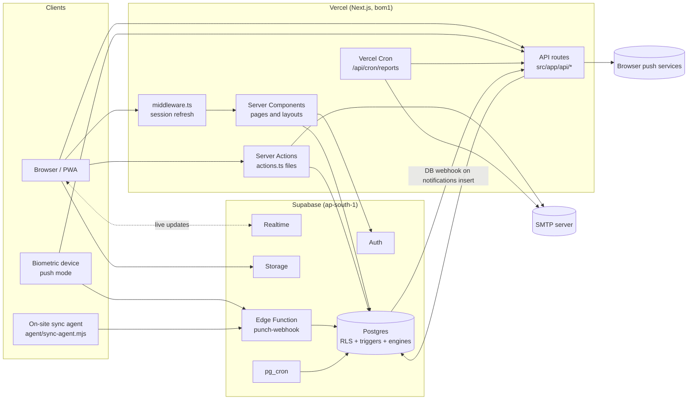
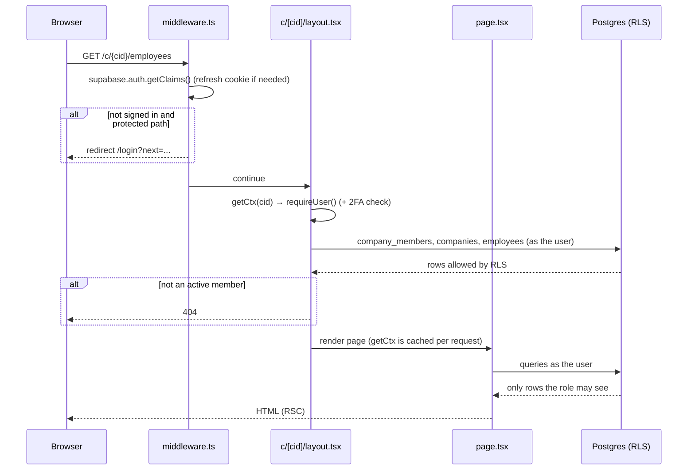
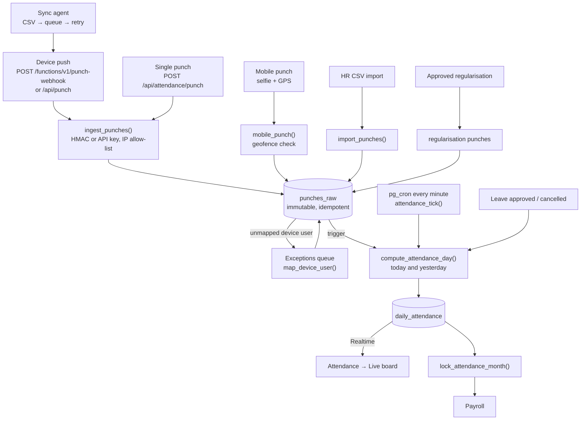
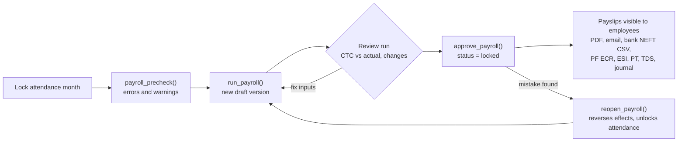
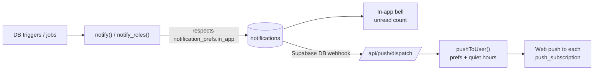

# System overview: corpgroup.com

This document explains how the application is put together, so a new developer can find their way around and make changes safely.
For the database in detail (every table, policy, trigger and function), see [`Database Architecture.md`](./Database%20Architecture.md).
For setup commands, see the [README](../README.md). For requirement-by-requirement status against the BRD, see [`BRD-coverage.md`](./BRD-coverage.md).

---

## 1. What the application is

corpgroup.com is a **multi-company (multi-tenant) workforce platform** for Indian businesses. One owner can run several companies, and every company is an isolated tenant.

| Module | BRD code | What it does |
|---|---|---|
| Auth | AUTH | Sign-up, password and email-code login, invites, reset, 2FA (TOTP), Google sign-in, login history |
| Companies and projects | COM | Companies, branches (with geofence), departments, designations, holidays, policies, projects |
| Employees | EMP | Employee master, bulk import, encrypted PAN / Aadhaar / bank, documents, lifecycle, org chart, assets |
| Attendance and leave | ATT | Biometric device ingestion, mobile selfie + GPS punch, daily status engine, regularisation, month lock, leave |
| Payroll | SAL | Salary structures, CTC, statutory deductions (PF / ESI / PT / LWF / TDS), payroll runs, payslips, bank and statutory files |
| Tasks | TSK | Tasks, sub-tasks, checklists, dependencies, recurring tasks, time logs, templates |
| Communication | COMMS | 1:1, group, department and project chat, files, announcements |
| Cross-module | X / NFR | Notifications (in-app, push, email), global search, exports, scheduled reports, audit log, DPDP data requests |

Not built yet: voice and video calls (Phase 2), the CRM add-on (Phase 3) and Hindi / Telugu UI.

---

## 2. Tech stack

| Layer | Technology |
|---|---|
| Web framework | **Next.js 15** (App Router, React Server Components, Server Actions), React 19, TypeScript |
| Styling | Tailwind CSS 4, `lucide-react` icons, `recharts` for charts |
| Database | **Supabase Postgres** with Row Level Security (RLS) |
| Auth | Supabase Auth (JWT sessions in cookies via `@supabase/ssr`), our own email OTP layer on top |
| Realtime | Supabase Realtime (live attendance, chat, notifications) |
| Files | Supabase Storage (logos, documents, selfies, chat, task files, archives) |
| Scheduled jobs | `pg_cron` in the database, Vercel Cron, GitHub Actions |
| Serverless edge | Supabase Edge Function `punch-webhook` (Deno) |
| Email | Nodemailer over SMTP |
| PDF / Excel | `@react-pdf/renderer` (payslips), `@cantoo/pdf-lib` (password-protected PDFs), SheetJS `xlsx` |
| Web push | `web-push` with VAPID keys, service worker in `public/sw.js` (the app is an installable PWA) |
| Validation | `zod` |
| Tests | Vitest + **PGlite** (Postgres compiled to WASM, loads the real migrations) |
| Hosting | Vercel (region `bom1`, Mumbai) + Supabase (Mumbai, `ap-south-1`) |
| Package manager | pnpm |

---

## 3. Architecture at a glance



### The core design decision: business rules live in the database

Most of the important logic is written in **PostgreSQL**, not in TypeScript:

- **Who can see or change what** is decided by RLS policies on every table. The UI only hides buttons; the database is what actually refuses.
- **Attendance calculation** (`compute_attendance_day`) and the **payroll engine** (`run_payroll`) are PL/pgSQL functions. A full payroll run is therefore not limited by serverless function time limits (SAL-27).
- **Integrity rules** (immutable punches, leave balance checks, month locks, same-company references, auto employee codes, edit windows on chat messages) are triggers.
- **Side effects** (notifications, task activity history, chat channel membership, audit log) are triggers too.

What this means for you:

1. Before adding a check in TypeScript, look for it in `supabase/migrations/`. It is probably already enforced there.
2. A new rule that must always hold belongs in a **new migration**, not only in a server action.
3. Errors raised in Postgres (`raise exception '...'`) reach the user as-is through `errorMessage()` in `src/lib/actions.ts`, so write them as user-facing sentences.

---

## 4. Repository layout

```
.
├── src/
│   ├── middleware.ts            Session refresh + redirect signed-out users to /login
│   ├── app/
│   │   ├── (auth)/              login, signup, verify, activate, forgot, set-password (+ actions.ts)
│   │   ├── auth/callback/       OAuth (Google) callback
│   │   ├── mfa/                 Second-factor (TOTP) challenge
│   │   ├── onboarding/          "No company yet" page for accounts without access
│   │   ├── owner/               Owner's consolidated view across companies (COM-07)
│   │   ├── admin/               Super-admin console: all tenants, plans, seats
│   │   ├── account/             Account & security (password, 2FA, email, sessions, history)
│   │   ├── privacy/             Privacy notice (DPDP)
│   │   ├── c/[cid]/             Everything scoped to one company (cid = company id)
│   │   │   ├── layout.tsx       Loads context (role, company, employee) and renders the Shell
│   │   │   ├── dashboard/  employees/  attendance/  leave/  payroll/
│   │   │   ├── tasks/  projects/  chat/  announcements/  notifications/
│   │   │   └── profile/  settings/
│   │   └── api/                 Route handlers (devices, exports, PDFs, push, cron, search)
│   ├── components/              Shared UI (Shell, ui.tsx primitives, forms, charts, 2FA…)
│   └── lib/
│       ├── supabase/            server.ts (user), client.ts (browser), admin.ts (service role)
│       ├── auth/                OTP rules, OTP store, session helpers, guard, accounts, config
│       ├── email/               Nodemailer transport and email templates
│       ├── context.ts           getCtx(cid): user + role + company + employee for a request
│       ├── rbac.ts              Role labels, role helpers, navigation per role
│       ├── actions.ts           Server-action helpers: attempt(), must(), FormData readers
│       ├── crypto.ts            AES-256-GCM field encryption (PAN / Aadhaar / bank)
│       ├── payslip-pdf.tsx      Payslip PDF renderer
│       ├── push.ts              Web push delivery (prefs + quiet hours)
│       └── employees.ts, attendance-summary.ts, format.ts
├── supabase/
│   ├── migrations/              The whole schema, in order (see Database Architecture.md)
│   ├── functions/punch-webhook/ Edge Function for biometric devices
│   └── config.toml
├── agent/sync-agent.mjs         On-site agent for LAN-only devices (buffers + retries)
├── scripts/                     seed.ts, archive-punches.ts, email-test.ts
├── tests/                       Vitest suites; tests/db.ts boots PGlite with the real migrations
├── public/                      PWA manifest, service worker, icons
├── .github/workflows/           ci, deploy-db, backup, archive
├── vercel.json                  Region (bom1) + daily cron
└── docs/                        This file, Database Architecture.md, BRD-coverage.md
```

---

## 5. How a request flows

### 5.1 Page load (read path)



Key points:

- `middleware.ts` does **no database work**. It only refreshes the session and bounces signed-out users from protected paths (`/c/`, `/owner`, `/onboarding`, `/set-password`, `/account`, `/admin`, `/mfa`). Device webhooks, push dispatch and cron routes are excluded from the matcher.
- `getCtx(cid)` in `src/lib/context.ts` is wrapped in React `cache()`, so the layout and the page share one lookup per request.
- `requireRole(ctx, roles)` redirects to the dashboard when the role should not see a page. This is a UX guard; RLS is the real one.

### 5.2 Mutations (write path)

Every module has an `actions.ts` with **Server Actions**. The usual pattern:

```ts
export async function approveRun(cid: string, runId: string, _: ActionState): Promise<ActionState> {
  return attempt(async () => {
    const { supabase } = await getCtx(cid);                         // user-scoped client, RLS applies
    must(await supabase.rpc("approve_payroll", { p_run: runId }));  // throw on { error }
    revalidatePath(`/c/${cid}/payroll`, "layout");                  // clear cached pages
    return "Payroll approved and locked.";                          // shown as a success toast
  });
}
```

- `attempt()` turns thrown errors into `{ error }` (friendly text for RLS / unique violations) and lets Next.js redirects through.
- `must()` unwraps a Supabase `{ data, error }` result and throws on error.
- Forms use `components/action-form.tsx` (`useActionState`) to show the result.
- After any write, call `revalidatePath` so the router cache (30 s dynamic, see `next.config.ts`) does not show stale data.

### 5.3 The three Supabase clients

| Client | File | Acts as | Use for |
|---|---|---|---|
| Server (user) | `lib/supabase/server.ts` | The signed-in user, RLS applies | **Default** for pages, actions and API routes |
| Browser | `lib/supabase/client.ts` | The signed-in user, RLS applies | Realtime subscriptions, direct Storage uploads |
| Admin | `lib/supabase/admin.ts` | `service_role`, **bypasses RLS** | Only where no user exists or Auth admin APIs are needed: OTP store, login attempts, device webhooks, cron, push delivery, creating auth users, super-admin console |

> **Rule:** never import the admin client into a page or action without first checking permissions yourself. It is marked `server-only` so it cannot leak to the browser.

---

## 6. Authentication and sessions

| Concern | How it works | Where |
|---|---|---|
| Session | Supabase JWT (access + refresh) in cookies. Verified locally with `getClaims()` (asymmetric ES256 keys), so it costs no network call | `middleware.ts`, `lib/auth/guard.ts` |
| Sign-up / invite / reset | Our own **email OTP**: a 6-digit code **and** a one-click link from one record. Hashed with `OTP_PEPPER`, 10-minute expiry, single use, 5 attempts, 60 s resend cooldown, 5 per hour per email and IP | `lib/auth/otp.ts` (pure, unit-tested), `lib/auth/otp-store.ts` (table `otp_codes`) |
| Email verification | Always on (BRD AUTH-01/03/04/05/13): owner sign-up, employee activation, sign-in by code, password reset and change of email go through a 6-digit emailed code. No administrator approval of sign-ups. Without SMTP, development servers print the email to the server log; production refuses to send and shows an error |
| Turning a verified email into a session | Server generates a magic-link token with the admin API and verifies it immediately | `lib/auth/session.ts → signInVerifiedEmail()` |
| Password rules + lockout | 8+ characters with a number and a special character. 5 failures in 15 minutes lock the account | `lib/auth/session.ts`, table `login_attempts` |
| Company at sign-in | The password sign-in form has a required **Company** dropdown (active companies from the database). After the password check the server calls `my_access(company)` as the signed-in user; anything but `allowed` signs the user straight out ("no access to the selected company" / "inactive", never naming other companies). On success the company lock cookie unlocks exactly that company and the user lands on its dashboard | `app/(auth)/actions.ts → loginPassword`, `lib/auth/company-login.ts`, `lib/auth/company-lock.ts` |
| Portals and sessions | **`/`** employee sign-in (company dropdown) and, once signed in, the company dashboard · **`/hr`** the same sign-in limited on the server to HR Managers of the selected company (`portal=hr` in `loginPassword`) · **`/admin`** the platform Super Admin portal with its **own session**: cookie `sb-admin-auth-token` on `Path=/admin` (`lib/supabase/scopes.ts`), read only by clients created with the `"admin"` scope, its own sign-in (`app/admin/actions.ts`) and two-factor page (`/admin/mfa`). The admin session ends **when the browser closes** (its cookies have no expiry) and **after 15 minutes without admin activity**: a signed, httpOnly stamp (`cg_admin_seen`, `lib/auth/admin-idle.ts`) is checked and renewed by the middleware on every `/admin` request, the console pings `/admin/ping` while in use, and an expired session is signed out (and revoked) → `/admin?expired=1`. An admin and an employee can therefore be signed in at once in one browser on one address, and signing out of either leaves the other. Employee, HR and company admins share the company session **per address**: its cookie belongs to the host name, so all tabs on one address are one account. For two company accounts at once in one browser (e.g. a company admin and an employee), the same app is opened at a second address — `NEXT_PUBLIC_SESSION_ORIGINS` (`lib/origins.ts`; development default `http://localhost:3000,http://127.0.0.1:3000`, production: two domains on the same deployment). The sign-in page and the profile menu offer "Sign in to another account in a new tab", which opens the other address. **Sign out** ends only this session (`scope: "local"`); *Log out of all devices* ends every session. `SessionGuard` reloads a tab whose session changed in another tab | `lib/supabase/scopes.ts`, `lib/supabase/{server,client}.ts`, `middleware.ts`, `app/admin/*`, `app/(auth)/hr/page.tsx`, `app/(auth)/login/company-sign-in.tsx`, `components/session-guard.tsx` |
| 2FA (TOTP) | Supabase MFA. `app_metadata.mfa_enrolled` is kept in sync so the token shows whether `aal2` is needed; `requireUser()` redirects to `/mfa` | `lib/auth/guard.ts`, `app/mfa` |
| Google sign-in | Optional (`NEXT_PUBLIC_GOOGLE_AUTH=on`), callback at `/auth/callback` | `components/google-button.tsx` |
| Login history | Every login is written to `login_history` (IP, user agent, method) | `recordLogin()` |
| Idle timeout | Per-user `profiles.idle_timeout_min` (default 30) enforced in the client shell | `components/shell.tsx` |
| Super admins | A row in `platform_admins` (granted only in SQL). `/admin` calls `sa_*` functions that check `is_super_admin()` | `app/admin/page.tsx`, migration 0018 |

---

## 7. Roles and permissions

Every user has one role **per company** in `company_members.role`: `owner`, `company_admin`, `hr` (HR / Payroll), `manager` or `employee`, the default matrix of BRD v2.0 §5.3 (migration 0027). Designation, department, manager, company and status are separate fields and grant nothing. Super Admin is platform-level (`platform_admins`, granted only in SQL) and is not a company role: it manages tenants and subscriptions and sees a company's data only while that company's Company Admin has granted **support access** (Settings → Support access, 1–72 hours, with a reason; `support_access`, `sa_acting`). Everything it does there is audited (`audit_log.via_super_admin`) and it can't approve payroll.

| Area | Owner | Company Admin | HR / Payroll (`hr`) | Manager | Employee |
|---|---|---|---|---|---|
| Companies | Create (sign-up, /owner), edit profile | Read, edit own company | Read | Read | Read |
| Projects | Full | Full | Read all | Read; update the projects they manage | Member projects (read) |
| Employees | Full, incl. system roles | Full, incl. system roles | Create, read, update, delete, invite, logins (no system roles) | Own team (read) | Own profile (read, update contact fields) |
| Attendance | Read | Full; only role that unlocks a month | Full (no unlock) | Team: read, approve | Own; punch / WFH check-in |
| Leave | Read | Full | Full | Team: read, approve | Apply, read own |
| Salaries / Payroll | Read, approve, reopen | Read, approve, reopen | Prepare: structures, CTC, inputs, run, bank file | Own payslips | Own payslips |
| Tasks | Full | Full | Full | Full for their team | Assigned tasks; create tasks for themselves |
| Settings and audit log | Read | Full | Read | None | None |
| Chat | Yes | Yes, plus chat controls | Yes | Yes | Yes |

- **Payroll:** HR / Payroll prepares and runs payroll; the Owner or a Company Admin approves (`salaries.approve`), never the person who ran that run (maker-checker). Employees and managers read their own approved payslips under **My payslips**.
- **Sign-up:** owners sign up with name, email and company name and become that company's Owner (`create_company_for`, 0028); an owner adds further companies from `/owner` or the company switcher. Employees don't self-register: HR adds them and sends an invitation (`join_requests` only keeps requests made before 0028).
- **Switching company** needs no new sign-in (AUTH-11): the signed `cg_company` cookie (`lib/auth/company-lock.ts`, `middleware.ts`) just records the company the session has open; membership is checked by `my_access` on every page.
- **Removing** an employee: exited, access revoked, `removed_at` set and hidden from lists; history kept. Employees with attendance or payroll history can't be deleted.
- The **staff directory** (`employee_directory`) shows every member only name, code, work email, photo, department, designation, branch, reporting line and status.
- Nobody can change their own membership or role. Choosing a system role needs `employees.assign_role` (Owner, Company Admin); invitations and logins need `employees.account` (also HR).

- The **database** is the source of truth: `role_permissions` maps roles to permissions, and RLS policies and functions call `has_perm(company, perm)`. `in_good_standing` denies users whose employee record is inactive or exited. Migrations `0018_rbac`, `0019_rbac_decisions` and `0027_brd_v2_alignment` (BRD v2.0 matrix).
- **At sign-in and on every request**, `getCtx()` (`lib/context.ts`) calls `my_access(company)` and gets `{allowed, reason, role, permissions}` from the server. Nothing the browser sends is trusted. A denied user goes to `/denied`.
- **Pages** call `requirePerm()`, which shows `/c/[cid]/denied` on a direct URL. **Server actions** call `assertPerm()`. **Exports** check `EXPORT_PERMISSION` in `/api/export`. The `NAV` list in `lib/rbac.ts` only decides what is shown.
- "Manager" rights over a person come from `employees.reporting_manager_id` plus the manager permissions.

---

## 8. Modules in detail

### 8.1 Companies, onboarding and tenants

- Only the platform Super Admin creates companies (`/admin` → `sa_create_company`, migration 0020) and names an existing account as Owner. Sign-up creates an account with no company; it lands on `/onboarding` ("not part of a company yet") until invited or assigned. Triggers then:
  - add the named owner as `owner` in `company_members` (plus an employee record);
  - **bootstrap** defaults: statutory settings, a 09:00–18:00 shift, leave types (CL, SL, EL, LOP), a "Standard" salary structure and two departments.
- Owners with several companies see `/owner` (consolidated view) and switch companies from the sidebar. `profiles.last_company_id` remembers the last one.
- Archiving a company sets `status = 'archived'`. A daily job purges it 90 days later.

### 8.2 Employees

**One person, several companies.** A person has one login and password; each company they work for has its own employee record and membership (department, designation, manager, role, status). The platform Super Admin manages this on the employee page → **Companies** tab: assign to more companies, edit each company's details, deactivate / reactivate one company only, and see the history (migration 0023). The login form's company dropdown and the sidebar switcher only open companies where `my_access` allows it; the switcher lists only those (`lib/company-switcher.ts`).

- Created one by one (`employees/new`) or by **bulk import** (Excel / CSV with row-level errors, `employees/import`).
- Employee code is generated by a trigger from `companies.emp_code_prefix` + `next_emp_seq` (e.g. `EMP0007`).
- **PAN, Aadhaar and bank account** are encrypted in Node with AES-256-GCM (`lib/crypto.ts`, key `FIELD_ENCRYPTION_KEY`) before they reach the database. Only `*_enc` ciphertext and the last 4 characters are stored.
- Employees can edit only phone, address, emergency contact and photo. Other changes (PAN, bank) go through `employee_change_requests` for HR approval. This is enforced by a trigger.
- Invites: HR sends an invite and the person activates at `/activate`. With verification off, HR can set a password directly.
- Lifecycle events (joined, transfer, promotion, resignation, exit, deactivation) are kept in `employee_events`. Onboarding checklist items are created automatically.

### 8.3 Attendance



- **Raw punches are never edited.** Corrections are new rows (`source = 'regularisation'`), and the only allowed update is attaching an unmapped punch to an employee.
- Sending the same punch again is harmless: unique indexes make inserts idempotent, so devices can resend their backlog.
- `compute_attendance_day` decides the day's status: present, late, early out, half day, absent, missed punch, on leave, holiday, weekly off, on duty or WFH. It also computes first in / last out, worked minutes, late minutes and overtime. It handles night shifts and the "every 3rd late = half day" rule (configurable).
- HR can override a day (`set_attendance_status`, `source = 'manual'`). Manual rows are never overwritten by the engine.
- **Month lock** freezes a month. It refuses while unmapped punches exist, and payroll can only run on a locked month.

### 8.4 Leave

- Leave types per company (paid / unpaid, yearly or monthly accrual, carry-forward cap, encashable, negative balance allowed).
- Balance = opening (`leave_balances`) + accrued − used − pending, computed by the view `leave_balance_view`.
- A trigger on `leave_requests` computes working days (excluding weekly offs and holidays), blocks overlaps, checks the balance, controls who may approve, and recomputes attendance when a decision changes.
- `carry_forward_leaves(company, year)` moves the capped balance into next year's opening.

### 8.5 Payroll



- The calculation follows BRD §9 in order: payable days → proration ratio → earnings (prorated components, arrears, OT, bonus, incentive, encashment, gratuity, reimbursements) → PF / ESI / PT / LWF → TDS (regime-aware projection) → loans and recoveries → net pay never below zero (shortfall carried forward) → rounding per line.
- Each run is **versioned**. Running again supersedes the previous draft, and `payroll_runs.changes` lists each employee whose net pay changed.
- **Maker-checker:** the Owner or a Company Admin approves (`salaries.approve`), never the person who ran that run; HR / Payroll prepares. The Super Admin cannot approve.
- Only the owner or a company admin can **reopen** a finalized run, with a reason and the month typed as `YYYY-MM` to confirm.
- Employees see their payslips only after the run is **locked**.
- Payslip PDFs are generated on demand (`/api/payslip/[id]`), optionally password-protected (`companies.payslip_password`).
- **Statutory rates are placeholders.** They must be verified with the company's CA before go-live (`statutory_settings.verified_on`).

### 8.6 Projects and tasks

- Projects have a manager and members. Creating a project creates its chat channel.
- Tasks have list / board / calendar views, assignees, comments with @mentions, attachments, activity history, sub-tasks, checklists, dependencies (a task cannot close while a blocker is open), recurrence (closing creates the next one), time logs and templates.
- Notifications for assignment, status change, mentions, due-in-24 h and overdue come from triggers and a `pg_cron` job.

### 8.7 Chat and announcements

- Conversation kinds: `dm` (one per pair), `group`, `department` and `project`. Department and project channels are created and their membership synced automatically.
- Messages support files up to 25 MB (stored at `chat/{company}/{conversation}/…`), reply, forward, pin, star, edit within 15 minutes and delete for everyone. Full-text search uses a `tsvector` column.
- Admin controls: block cross-department DMs, retention period (default 730 days, purged nightly), and a logged compliance export.
- Announcements notify every member and track acknowledgements.
- Live updates use Supabase Realtime on `messages`, `conversation_members`, `notifications` and `daily_attendance`.

### 8.8 Notifications



- The notification `kind` is derived from the link (`/leave` → leave, `/tasks/…` → tasks, and so on), so per-type preferences work without extra code.
- Chat messages create `kind = 'chat'` rows only to drive push. The bell ignores them, and they are purged after 7 days.

### 8.9 Reports, exports and search

- `/api/export/[report]`: Excel / CSV exports (employees, attendance muster, payroll files…). They run as the user, so RLS applies.
- "PDF" for lists uses a print layout (`components/print-button.tsx`).
- Scheduled report emails: `report_schedules` + `/api/cron/reports` (daily Vercel cron, protected by `CRON_SECRET`).
- Global search (⌘K) is `/api/search` and runs as the user.

### 8.10 Privacy (DPDP)

- Consent is recorded at sign-up and activation (`profiles.consent_at`).
- `/api/my-data` lets anyone download the personal data held about them (sensitive values stay masked).
- `data_requests` records export and deletion requests and notifies admins.

---

## 9. External entry points (API routes)

| Route | Auth | Purpose |
|---|---|---|
| `POST /api/punch` | Device: `x-device-serial` + `x-signature` (HMAC-SHA256 of body) or `x-api-key` | Batch punch webhook (same contract as the Edge Function) |
| `POST /api/attendance/punch` | Device API key or HMAC | One punch per request; `201` for new, `200 {duplicate:true}` for a repeat |
| `POST <supabase>/functions/v1/punch-webhook` | As `/api/punch` | Edge Function variant (preferred for devices) |
| `POST /api/push/dispatch` | Header `x-webhook-secret` = `PUSH_WEBHOOK_SECRET` | Called by the Supabase DB webhook on new notifications |
| `POST/DELETE /api/push/subscribe` | User session | Save or remove this browser's push subscription |
| `GET /api/cron/reports` | `Authorization: Bearer <CRON_SECRET>` | Scheduled report emails |
| `GET /api/export/[report]` | User session | Excel / CSV exports |
| `GET /api/payslip/[id]` | User session (RLS) | Payslip PDF |
| `GET /api/search` | User session | Global search |
| `GET /api/link-preview` | User session | Chat link previews, SSRF-safe (private IPs refused) |
| `GET /api/my-data` | User session | DPDP personal data download |
| `GET /auth/callback` | OAuth | Google sign-in callback |

---

## 10. Background jobs

| Job | Runs on | Schedule | What it does |
|---|---|---|---|
| `attendance-tick` | pg_cron | every minute | Recomputes today and yesterday for every active company, then `check_devices()` marks devices offline after 15 minutes and alerts admins |
| `task-reminders` | pg_cron | every 5 min | "Due within 24 h" and "overdue" task notifications |
| `purge-chat` | pg_cron | 02:15 daily | Deletes messages past each company's retention, and chat notifications older than 7 days |
| `purge-archived-companies` | pg_cron | 02:30 daily | Deletes companies archived more than 90 days ago |
| `document-expiry` | pg_cron | 03:00 daily | Notifies HR 30 days before an employee document expires |
| Scheduled reports | Vercel Cron | 03:30 UTC daily | `/api/cron/reports` |
| Nightly backup | GitHub Actions | 21:30 UTC (03:00 IST) | Encrypted `pg_dump`, kept 30 days as an artifact |
| Punch archive | GitHub Actions | monthly | `scripts/archive-punches.ts --apply`: punches older than 13 months → Storage `archives`, then purged |

> `pg_cron` must be enabled in Supabase (Database → Extensions) and `pnpm db:push` run again, otherwise the cron blocks in the migrations only log a notice.

---

## 11. Security model

| Area | Measure |
|---|---|
| Tenant isolation | `company_id` on every tenant row + RLS on every table + triggers that force child rows to use their parent's company (NFR-04). Covered by `tests/rls-isolation.test.ts` |
| Secrets | `SUPABASE_SERVICE_ROLE_KEY`, `OTP_PEPPER` and `FIELD_ENCRYPTION_KEY` are server-only. Device secrets live in `device_secrets`, which has no RLS policies |
| Sensitive fields | PAN / Aadhaar / bank encrypted with AES-256-GCM. Only the last 4 characters are stored in clear |
| OTP | Codes and link tokens are stored only as hashes, with rate limits per email and IP |
| Internal DB functions | `EXECUTE` is revoked from app roles for engines, jobs, `notify()`, `ingest_punches()` and the purge functions |
| Audit | `audit_log` written by triggers on sensitive tables plus explicit entries (unlock, reopen, chat export) |
| Network | Link previews refuse private, loopback and link-local addresses and re-check redirects |
| Devices | HMAC signature or hashed API key, optional IP allow-list per device |
| Backups | Nightly encrypted dump (Supabase Free has none) |

---

## 12. Configuration

All settings are environment variables. Copy `.env.example` to `.env.local`.

| Variable | Required | Notes |
|---|---|---|
| `NEXT_PUBLIC_SUPABASE_URL`, `NEXT_PUBLIC_SUPABASE_ANON_KEY` | yes | Supabase project API settings |
| `SUPABASE_SERVICE_ROLE_KEY` | yes | Server only |
| `NEXT_PUBLIC_APP_URL`, `NEXT_PUBLIC_APP_NAME` | yes | Used in emails and links |
| `OTP_PEPPER` | yes | `openssl rand -hex 32` |
| `FIELD_ENCRYPTION_KEY` | yes | `openssl rand -base64 32`. **Losing it makes stored PAN / Aadhaar / bank unreadable** |
| `SMTP_*`, `MAIL_FROM` | for email | Empty `SMTP_HOST` prints emails to the dev console. Test with `pnpm email:test you@example.com` |
| `NEXT_PUBLIC_VAPID_PUBLIC_KEY`, `VAPID_PRIVATE_KEY`, `VAPID_SUBJECT`, `PUSH_WEBHOOK_SECRET` | for push | Plus the Supabase DB webhook on `notifications` INSERT |
| `CRON_SECRET` | for reports | Protects `/api/cron/*` |
| `NEXT_PUBLIC_GOOGLE_AUTH` | no | `on` after enabling Google in Supabase Auth |

GitHub Actions secrets: `SUPABASE_ACCESS_TOKEN`, `SUPABASE_DB_PASSWORD`, `SUPABASE_PROJECT_REF`, `SUPABASE_URL`, `SUPABASE_SERVICE_ROLE_KEY`, `SUPABASE_DB_URL`, `BACKUP_PASSPHRASE`.

### UI, design tokens and themes

- **Tokens** live in `src/app/globals.css` (Tailwind v4 `@theme`): indigo `brand-*`, slate neutrals, Inter, and the shared `input`, `label`, `btn-*`, `card`, `th`/`td` utilities. Shared building blocks are in `src/components/ui.tsx` (PageHeader, Card, Stat, Badge, Table, Tabs, Empty, Avatar), `shell.tsx` (sidebar, top bar, profile menu, phone bottom bar) and `sheet.tsx` (side panel / phone bottom sheet for row actions).
- **Light / Dark**: each person picks a theme in the profile menu (or the sun/moon button in the top bar and on the sign-in pages). `src/components/theme-toggle.tsx` applies it at once and saves the `cg_theme` cookie (one year, `SameSite=Lax`); the root layout reads the cookie and renders `<html class="dark">`, so pages open in the chosen theme without a flash. Default: light.
- **How dark works**: pages keep using the Tailwind palette. Under `html.dark`, `globals.css` remaps it: neutrals invert, tints (`*-50…200`) become dark washes and deep shades (`*-600…900`) become light, so existing classes stay readable. Solid fills that must not flip use fixed tokens: `bg-surface` (cards, inputs), `bg-accent` / `bg-accent-hover` (primary buttons, counters), `bg-danger`, `bg-hero` (sign-in panel), `bg-scrim` (overlays). Use those for new solid fills instead of `bg-white` or `bg-brand-600`. Charts (`charts.tsx`) switch palette in JS because SVG attributes can't read CSS variables. Printing always uses the light theme.
- **Contrast**: body text, muted text (`slate-500`) and placeholders meet WCAG 2.2 AA (4.5:1) in both themes; use `slate-400` only for icons, never for text.
- **Phones**: below 1024 px the sidebar becomes a drawer and a bottom bar shows Home plus up to three of Attendance, Employees, Tasks and Chat (whatever the role can open), and More. Wide tables on the priority pages (employees, daily attendance) switch to card lists below 768 px; other tables scroll inside their card.

---

## 13. Development workflow

### Everyday commands

```bash
pnpm dev            # http://localhost:3000 (Turbopack)
pnpm test           # Vitest; loads the real migrations into PGlite, no Docker needed
pnpm lint && pnpm typecheck && pnpm build
pnpm db:push        # apply supabase/migrations to the linked project
pnpm seed           # demo data: demo@corpgroup.com / Demo@1234
```

### CI / CD

| Workflow | Trigger | Steps |
|---|---|---|
| `ci.yml` | every PR and push to `main` | lint → typecheck → tests (migrations, payroll scenarios, RLS isolation) |
| `deploy-db.yml` | push to `main` touching `supabase/**` | `supabase db push` + deploy `punch-webhook` |
| Vercel Git integration | push to `main` | Builds and deploys the web app |

### Recipe: adding a feature

1. **Schema first.** Add a new file `supabase/migrations/<timestamp>_<name>.sql`. Never edit a migration that has already been applied to production.
2. For every new tenant table: add `company_id uuid not null references companies(id) on delete cascade`, run `enable row level security`, and write policies using the existing helpers (`is_member`, `is_hr`, `has_role`, `can_view_employee`…). Add a same-company trigger if the row references other tenant rows. Add an `audit_trigger` if HR or admins change it.
3. Put rules that must always hold in triggers or `security definer` functions. Revoke `EXECUTE` from `public, anon, authenticated` on internal functions.
4. Add a test in `tests/` (see `tests/db.ts` for the PGlite harness and how to act as a given user).
5. Build the page under `src/app/c/[cid]/<module>/`, with mutations in that folder's `actions.ts` using `getCtx` + `attempt` + `must` + `revalidatePath`.
6. If it needs a menu entry, add it to `NAV` in `src/lib/rbac.ts` with the right `show` rule.
7. Update `docs/BRD-coverage.md` and, if the schema changed, `docs/Database Architecture.md`.

### Conventions

- Server-only modules start with `import "server-only"`.
- Path alias `@/` → `src/`.
- Dates are stored as `date` / `timestamptz`. Company-local time uses `companies.timezone` (default `Asia/Kolkata`).
- Money is `numeric` in rupees, rounded to the rupee on payslip lines.
- Comments reference BRD requirement IDs (e.g. `ATT-11`, `SAL-24`). Keep doing this so code can be traced back to requirements.

---

## 14. Open items before go-live

Summarised from the README. Details in [`BRD-coverage.md`](./BRD-coverage.md).

- Statutory values (PF / ESI / PT slabs / TDS slabs) are placeholders and need the CA to verify them.
- CTC is treated as annual gross. Employer PF / ESI are on top, not carved out.
- The bank file is a generic NEFT CSV and needs adjusting per bank template.
- Vendor-specific biometric connectors wait for the customers' device list. The generic push contract and CSV import work today.
- Upgrade Vercel (Hobby is non-commercial) and Supabase (Free has no backups) before taking paying customers.
